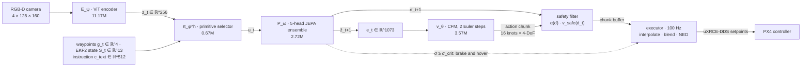

# Aero-VPA: Few-Step Flow-Matching Control over Non-Reconstructive JEPA Latents for Agile Flight on Edge Hardware

[](LICENSE)
[](https://doi.org/10.5281/zenodo.23633375)
[](https://www.python.org/)
[](https://pytorch.org/)
[](https://docs.ros.org/en/humble/)
[](#scope-of-this-release)
[](https://github.com/ylee-sling/Aero-VPA/actions/workflows/selftest.yml)



Reference PyTorch implementation of **Aero-VPA**, a Vision-Predictor-Action controller for agile three-dimensional
flight on a 15 W embedded computer. Author: Dr. Yeonseok Lee, SLING AI Inc.
Preprint: [doi.org/10.5281/zenodo.23633375](https://doi.org/10.5281/zenodo.23633375) (open access, Zenodo, 2026).

## Core contribution

Vision-Language-Action models emit actions through an autoregressive language decoder: the number of sequential
forward passes grows with the action horizon, and on a memory-bandwidth-bound module each pass costs at least the
time needed to stream billions of weights. Aero-VPA removes the decoder from the control loop:

* **Non-reconstructive world model.** A 4-channel RGB-D Vision Transformer is trained as a Joint-Embedding Predictive
  Architecture with VICReg regularisation: it predicts future *embeddings*, not pixels, so it never has to model
  illumination, texture or sensor noise that is irrelevant to control.
* **Few-step flow matching.** A conditional flow-matching head integrates a learned vector field in **two Euler
  steps** to produce a whole 16-knot chunk of heading-frame velocity and yaw-rate setpoints. A decision takes
  **five sequential network evaluations**, independent of the chunk length.
* **Uncertainty-gated safety.** The disagreement of a 5-head predictor ensemble attenuates speed, shortens chunk
  validity and triggers a minimum-jerk stop to hover; a model-free braking envelope limits speed to the measured
  free space.
* **Edge deployment.** 18.13M parameters (~36.3 MB of FP16 weights) for an asynchronous two-rate stack on an NVIDIA
  Jetson Orin Nano streaming 100 Hz setpoints to PX4.

## Scope of this release

This repository contains the model and the closed-loop runtime in PyTorch: all networks of Table 1, the training
objectives, the safety layer and Algorithm 1 (decision loop and 100 Hz executor), with offline self-tests.
The preprint specifies its benchmark protocol before execution and reports **no experimental results**; this
release likewise ships **no trained weights and no flight results**. ROS 2 nodes, TensorRT engines and the
SITL / HITL harness of Sections 4-5 are deployment targets of the paper and are not part of this release.

## Parameter budget (Table 1)

Counted from the instantiated modules by the self-tests.

| Module | Parameters | Exact Count | Role |
| :--- | :--- | :--- | :--- |
| **Vision Encoder ($E_\psi$)** | 11.17M | 11,171,200 | 4-channel RGB-D ($128 \times 160$) ViT to $d=256$ latent |
| **Primitive Selector ($\pi_\phi^h$)** | 0.67M | 668,166 | 6 flight primitives from $[z_t, g_t, S_t, c_{text}]$ (785-dim) |
| **JEPA Predictor ($P_\omega$)** | 2.72M | 2,720,192 | 5-head ensemble forecasting $z_{t+1}$ and uncertainty $\sigma$ |
| **CFM Solver ($v_\theta$)** | 3.57M | 3,572,228 | 16-knot 4-DoF heading velocity chunk from 1073-dim $e_t$ |
| **Total** | **18.13M** | **18,131,786** | ~36.3 MB of FP16 weights |

The total is the sum of the four networks above. Two small embeddings are also trainable: the solver's primitive
embedding (6 × 32 = 192) and the learned null text embedding (512), for 18,132,490 trainable parameters in all;
every figure rounds to 18.13M. Not counted: the EMA target encoder (no gradients) and the frozen CLIP text tower
(63.4M, evaluated once per mission).

## Mathematical invariants

* **Sequential depth (Sec. 3.7, Eq. 29).** A decision is the chain
  $E_\psi \to \pi_\phi^h \to P_\omega \to v_\theta^{K}$: exactly $K + 3 = 5$ sequential network evaluations for
  $K = 2$, independent of the horizon $H$. `pipeline.py` audits the chain at runtime with forward hooks and raises
  on any extra, missing or reordered evaluation (3 evaluations when the safety override skips the solver).
* **Chunk coherence (Proposition 3.1).** With noise persistence ($\xi_t = \xi_{t-1}$ while the primitive is
  unchanged, Eq. 20), consecutive chunks satisfy
  $\lVert \Phi_K(\xi; e) - \Phi_K(\xi; e') \rVert_F \le \frac{L_e}{L_A}\left[(1 + L_A/K)^K - 1\right] \lVert e - e' \rVert_2$.
  The constants are not controlled by training, so this explains the mechanism rather than certifying a bound;
  the self-test checks it exactly (with equality) on an affine field and as a local Lipschitz property of the real
  network.
* **Stop within measured free space (Proposition 3.2).** The speed envelope
  $v_{safe}(d) = \frac{2a_{max}}{3}\left(-T_r + \sqrt{T_r^2 + 3(d - \epsilon_d - r_s)/a_{max}}\right)$
  and the minimum-jerk braking profile (Eq. 26) stop the vehicle short of every obstacle point imaged in the
  depth region, **under the assumptions of the paper**: static obstacles, depth error at most $\epsilon_d$,
  braking within $T_r$, and tracking with deceleration at most $a_{max}$.

## Quick start

```bash
git clone https://github.com/ylee-sling/Aero-VPA.git
cd Aero-VPA
python -m pip install -r requirements-dev.txt      # torch 2.14.1, transformers, ruff

# offline self-tests, in dependency order (CPU, deterministic, float64 references)
python config.py
python perception.py
python predictor.py
python selector.py
python solver.py
python pipeline.py

# the release checks: headers, licence files, citation metadata, lint and all self-tests
python scripts/check_release.py --run-tests
```

Closed-loop use, after training stage (i) and (ii) and calibrating the uncertainty thresholds on validation
flights (Sec. 3.5):

```python
from config import VPAConfig
from pipeline import Observation, VPAInferencePipeline

cfg = VPAConfig(sigma_lo=0.2, sigma_crit=0.6)                 # calibrated quantiles of sigma_bar
pipe = VPAInferencePipeline.from_config(cfg, latency_bound=0.05, tracking_lag=0.03)  # loads CLIP ViT-B/32
pipe.calibrate(gamma_bar_star, latent_mean, proprio_mean, proprio_std)   # frozen statistics of stage (i)
pipe.reset("inspect the second floor", waypoints)             # waypoints: [B, M, 3] in NED (m)

s_t = pipe.proprioception(velocity_ned, gravity_body, body_rates, yaw)   # S_t, Eq. 2
out = pipe.act(now, Observation(image, s_t, position, yaw, clearance, capture_time))
out.velocity, out.acceleration, out.yaw_rate                  # PX4 TrajectorySetpoint fields (NED)
```

`image` is the normalised RGB-D frame `[B, 4, 128, 160]` (see `perception.RGBDNormalizer`); `clearance` is the
metric range $d_t$ `[B]` of Eq. 27, or a callable that receives the predicted chunk and returns it.

## Repository layout

| File | Paper | Contents |
| :--- | :--- | :--- |
| `config.py` | Secs. 3-4, Table 1 | `VPAConfig`, derived dimensions, Table 1 budget |
| `perception.py` | Sec. 3.2, Eq. 6 | `RGBDNormalizer`, `VisionEncoder`, `MomentumEncoder`, `TextEncoderWrapper` |
| `predictor.py` | Secs. 3.2, 3.5, Eqs. 7-11, 22 | `JEPAPredictor`, `VICRegLoss`, `LatentScaleTracker` |
| `selector.py` | Secs. 3.1, 3.3, Eqs. 3, 12-14 | `PrimitiveSelector`, `primitive_labels`, `goal_feature`, `WaypointTracker` |
| `solver.py` | Secs. 3.4-3.6, Eqs. 15-28 | `ConditionalVectorField`, `CFMSolver`, `NoisePersistence`, `SafetyFilter` |
| `pipeline.py` | Sec. 3.7, Algorithm 1 | `VPAInferencePipeline`: `calibrate`, `reset`, `step`, `tick`, `act` |
| `docs/` | | the preprint PDF (CC BY 4.0, see [`docs/README.md`](docs/README.md)) |
| `scripts/` | | `check_release.py` (release hygiene), `release.sh` (tag and publish) |
| `.github/workflows/` | | CI: release checks, lint and self-tests on Python 3.10 and 3.13 (CPU) |

## Verification

The six self-tests pass on Linux x86_64 with Python 3.10.20 and 3.13.17 and PyTorch 2.14.1 (CPU), and the code passes
`ruff check --select F,E9,B,PLE,PLW`. Every float64 reference comparison meets rtol = 1e-5, atol = 1e-6 except
the sinusoidal flow-time embedding (4.1e-5 absolute: its arguments reach 1000 rad, where float32 argument rounding
alone is ~3e-5). Comparisons of the full Table 1 networks are coded with rtol = 1e-4, atol = 1e-5 to leave margin
for other BLAS back ends. The `pipeline.py` suite was mutation-tested: ten deliberately planted defects are each
caught.

## License

* **Code:** [GPL-3.0-only](LICENSE). Every source file carries
  `SPDX-License-Identifier: GPL-3.0-only` and `Copyright (C) 2026 SLING AI Inc.`
* **Preprint PDF in `docs/`:** not covered by the GPL. Copyright (C) 2026 Yeonseok Lee, licensed under
  [CC BY 4.0](https://creativecommons.org/licenses/by/4.0/); see [`docs/README.md`](docs/README.md).
* **Commercial licensing:** For commercial integration, proprietary licensing, or defense adaptation, contact ylee@sling.ai.kr.

## Citation

If you use this code or the method, please cite the preprint ([`CITATION.cff`](CITATION.cff) has the same entry):

```bibtex
@misc{lee2026aerovpa,
  author    = {Lee, Yeonseok},
  title     = {Aero-VPA: Few-Step Flow-Matching Control over Non-Reconstructive JEPA Latents for Agile Flight on Edge Hardware},
  year      = {2026},
  publisher = {Zenodo},
  doi       = {10.5281/zenodo.23633375},
  url       = {https://github.com/ylee-sling/Aero-VPA},
  note      = {Preprint}
}
```

## Contact

Dr. Yeonseok Lee, SLING AI Inc. — ylee@sling.ai.kr
