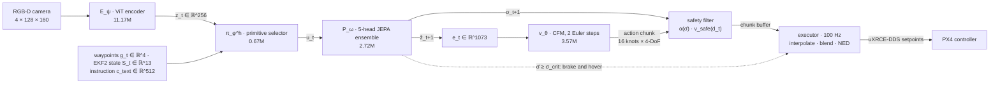

# Aero-VPA: Few-Step Flow-Matching Control over Non-Reconstructive JEPA Latents for Agile Flight on Edge Hardware

[](LICENSE)
[](https://doi.org/10.5281/zenodo.23633375)
[](https://www.python.org/)
[](https://pytorch.org/)
[](https://docs.ros.org/en/humble/)
[](#scope-of-this-release)
[](https://github.com/ylee-sling/Aero-VPA/actions/workflows/selftest.yml)



Reference PyTorch implementation of **Aero-VPA**, a Vision-Predictor-Action controller for agile three-dimensional
flight on a 15 W embedded computer. Author: Dr. Yeonseok Lee, SLING AI Inc.
Preprint: [doi.org/10.5281/zenodo.23633375](https://doi.org/10.5281/zenodo.23633375) (open access, Zenodo, 2026).

## Core contribution

Vision-Language-Action models emit actions through an autoregressive language decoder: the number of sequential
forward passes grows with the action horizon, and on a memory-bandwidth-bound module each pass costs at least the
time needed to stream billions of weights. Aero-VPA removes the decoder from the control loop:

* **Non-reconstructive world model.** A 4-channel RGB-D Vision Transformer is trained as a Joint-Embedding Predictive
  Architecture with VICReg regularisation: it predicts future *embeddings*, not pixels, so it never has to model
  illumination, texture or sensor noise that is irrelevant to control.
* **Few-step flow matching.** A conditional flow-matching head integrates a learned vector field in **two Euler
  steps** to produce a whole 16-knot chunk of heading-frame velocity and yaw-rate setpoints. A decision takes
  **five sequential network evaluations**, independent of the chunk length.
* **Uncertainty-gated safety.** The disagreement of a 5-head predictor ensemble attenuates speed, shortens chunk
  validity and triggers a minimum-jerk stop to hover; a model-free braking envelope limits speed to the measured
  free space.
* **Edge deployment.** 18.13M parameters (~36.3 MB of FP16 weights) for an asynchronous two-rate stack on an NVIDIA
  Jetson Orin Nano streaming 100 Hz setpoints to PX4.

## Scope of this release

This repository contains the model and the closed-loop runtime in PyTorch: all networks of Table 1, the training
objectives, the safety layer and Algorithm 1 (decision loop and 100 Hz executor), with offline self-tests.
`sim/` adds the Phase 1 data pipeline: a headless Gazebo Harmonic + PX4 SITL stack, the privileged expert of
Section 5.1, and an HDF5 writer whose files `dataset.py` loads. The training scripts run stages (i) and (ii) of
Section 3.8 on those files, calibrate the uncertainty thresholds of Section 3.5, and write one checkpoint that
`VPAInferencePipeline.from_checkpoint` loads.
The preprint specifies its benchmark protocol before execution and reports **no experimental results**; this
release likewise ships **no trained weights, no demonstrations and no flight results**. ROS 2 control nodes,
TensorRT engines and the HITL harness of Sections 4-5 are deployment targets of the paper and are not part of
this release.

## Parameter budget (Table 1)

Counted from the instantiated modules by the self-tests.

| Module | Parameters | Exact Count | Role |
| :--- | :--- | :--- | :--- |
| **Vision Encoder ($E_\psi$)** | 11.17M | 11,171,200 | 4-channel RGB-D ($128 \times 160$) ViT to $d=256$ latent |
| **Primitive Selector ($\pi_\phi^h$)** | 0.67M | 668,166 | 6 flight primitives from $[z_t, g_t, S_t, c_{text}]$ (785-dim) |
| **JEPA Predictor ($P_\omega$)** | 2.72M | 2,720,192 | 5-head ensemble forecasting $z_{t+1}$ and uncertainty $\sigma$ |
| **CFM Solver ($v_\theta$)** | 3.57M | 3,572,228 | 16-knot 4-DoF heading velocity chunk from 1073-dim $e_t$ |
| **Total** | **18.13M** | **18,131,786** | ~36.3 MB of FP16 weights |

The total is the sum of the four networks above. Two small embeddings are also trainable: the solver's primitive
embedding (6 × 32 = 192) and the learned null text embedding (512), for 18,132,490 trainable parameters in all;
every figure rounds to 18.13M. Not counted: the EMA target encoder (no gradients) and the frozen CLIP text tower
(63.4M, evaluated once per mission).

## Mathematical invariants

* **Sequential depth (Sec. 3.7, Eq. 29).** A decision is the chain
  $E_\psi \to \pi_\phi^h \to P_\omega \to v_\theta^{K}$: exactly $K + 3 = 5$ sequential network evaluations for
  $K = 2$, independent of the horizon $H$. `pipeline.py` audits the chain at runtime with forward hooks and raises
  on any extra, missing or reordered evaluation (3 evaluations when the safety override skips the solver).
* **Chunk coherence (Proposition 3.1).** With noise persistence ($\xi_t = \xi_{t-1}$ while the primitive is
  unchanged, Eq. 20), consecutive chunks satisfy
  $\lVert \Phi_K(\xi; e) - \Phi_K(\xi; e') \rVert_F \le \frac{L_e}{L_A}\left[(1 + L_A/K)^K - 1\right] \lVert e - e' \rVert_2$.
  The constants are not controlled by training, so this explains the mechanism rather than certifying a bound;
  the self-test checks it exactly (with equality) on an affine field and as a local Lipschitz property of the real
  network.
* **Stop within measured free space (Proposition 3.2).** The speed envelope
  $v_{safe}(d) = \frac{2a_{max}}{3}\left(-T_r + \sqrt{T_r^2 + 3(d - \epsilon_d - r_s)/a_{max}}\right)$
  and the minimum-jerk braking profile (Eq. 26) stop the vehicle short of every obstacle point imaged in the
  depth region, **under the assumptions of the paper**: static obstacles, depth error at most $\epsilon_d$,
  braking within $T_r$, and tracking with deceleration at most $a_{max}$.

## Quick start

```bash
git clone https://github.com/ylee-sling/Aero-VPA.git
cd Aero-VPA
python -m pip install -r requirements-dev.txt      # torch 2.14.1, transformers, ruff

# offline self-tests, in dependency order (CPU, deterministic, float64 references)
python config.py
python perception.py
python predictor.py
python selector.py
python solver.py
python pipeline.py
python checkpoint.py
python sim/expert.py       # expert planner, labels and HDF5 schema (cross-checked against selector.py)
python dataset.py          # dry-run file -> inspect_hdf5 -> stage (i) and (ii) training steps
python train_stage1.py --self-test
python cache_latents.py --self-test
python train_stage2.py --self-test
python calibrate_sigma.py --self-test   # the whole chain on dry-run data, checked against the closed loop
python diagnose_stage1.py --self-test
python probe_depth.py --self-test
python clearance.py
python sim/fly_policy.py --self-test   # dry-run flights with an untrained policy
python sim/summarize_flights.py --self-test
python envelope_check.py --self-test
python sim/show_trace.py --self-test
python input_sensitivity.py --self-test
python sim/dagger.py       # stage (iii): expert labels, takeover gate and recording on a kinematic vehicle

# the release checks: headers, licence files, citation metadata, lint and all self-tests
python scripts/check_release.py --run-tests
```

Closed-loop use, after training stages (i) and (ii) and calibrating the uncertainty thresholds on validation
flights (Sec. 3.5; see Phase 2 below):

```python
from pipeline import Observation, VPAInferencePipeline

pipe = VPAInferencePipeline.from_checkpoint("checkpoints/policy.pt", latency_bound=0.05, tracking_lag=0.03)
pipe.reset(None, waypoints)                                   # instruction (None: none); waypoints [B, M, 3] NED (m)

s_t = pipe.proprioception(velocity_ned, gravity_body, body_rates, yaw)   # S_t, Eq. 2
out = pipe.act(now, Observation(image, s_t, position, yaw, clearance, capture_time))
out.velocity, out.acceleration, out.yaw_rate                  # PX4 TrajectorySetpoint fields (NED)
```

`image` is the normalised RGB-D frame `[B, 4, 128, 160]` (see `perception.RGBDNormalizer`); `clearance` is the
metric range $d_t$ `[B]` of Eq. 27, or a callable that receives the predicted chunk and returns it.

## Phase 1: simulation data collection

Expert demonstrations for stages (i) and (ii) (Secs. 3.8, 5.1) are collected in Gazebo Harmonic with PX4 SITL
v1.17 on Ubuntu 22.04, headless, with GPU rendering through EGL. The vehicle is `x500_vpa`: the PX4
`gz_x500_depth` airframe (parameters of autostart 4002, same OakD-Lite mount) whose two unaligned sensors
(1920 × 1080 RGB and 640 × 480 depth, different fields of view, 30 Hz) are replaced by one `rgbd_camera` that
renders colour and depth from the same viewpoint at the network resolution, 160 × 128, and at the knot rate
of 50 Hz.

```bash
# 1. dry run (no ROS, no Gazebo): kinematic vehicle + ray-cast RGB-D, same recording code and schema
python sim/collect_expert_dataset.py --dry_run --num_episodes 2 --output pilot_sample.hdf5
python inspect_hdf5.py pilot_sample.hdf5

# 2. pilot in Gazebo + PX4 (starts Xvfb/EGL, MicroXRCEAgent, gz, PX4, ros_gz_bridge; stops them on exit)
sim/run_headless_sitl.sh --px4-dir ~/PX4-Autopilot --ros-ws ~/px4_ros_ws -- \
    python3 sim/collect_expert_dataset.py --num_episodes 2 --output pilot_sample.hdf5
python inspect_hdf5.py pilot_sample.hdf5                   # exit status 1 on any schema violation

# 3. scale-up: 200 worlds x 10 flights = 2,000 demonstrations (Sec. 5.1). collect_worlds.sh starts one stack
#    per world and resumes: a run that ends early (a collision needs a fresh simulator, exit status 3) is
#    restarted with --append and a new mission seed, and complete worlds are skipped, so it can be rerun at
#    any time. --instance N runs several sweeps side by side (own DDS port, ROS domain and gz partition);
#    about one stack per 4 vCPUs.
python sim/make_world.py --seed 0 --count 200 --density sparse   # sim/worlds/*.sdf + privileged *.json
sim/collect_worlds.sh --instance 0 sim/worlds/aero_forest_sparse_s00{00..99}.sdf -- --compression lzf
sim/collect_worlds.sh --instance 1 sim/worlds/aero_forest_sparse_s01{00..99}.sdf -- --compression lzf
python inspect_hdf5.py --quiet data/*.hdf5
```

```python
from dataset import make_dataloader, text_conditioning
stage1 = make_dataloader("data/*.hdf5", stage=1, batch_size=256, num_workers=8)  # I_t, S_t, u_t, a_bar_t, I_{t+0.1 s}
stage2 = make_dataloader("data/*.hdf5", stage=2, batch_size=256, num_workers=8)  # I_t, S_t, g_t, x, A_t, u*_t
```

Each sample is one RGB-D frame. The odometry is paired by interpolation at the frame's capture time (PX4
stamps in simulation time, `UXRCE_DDS_SYNCT=0`), `S_t` carries the setpoint dispatched most recently before
it, and the 16-knot expert chunk is evaluated at the same instant in the heading frame of that instant.
Episode layout (`sim/expert.py` documents every attribute):

| Dataset | Shape | Type | Content |
| :--- | :--- | :--- | :--- |
| `observations/images` | (T, 128, 160, 4) | uint16 | R, G, B in [0, 255]; D in mm (0 = invalid) |
| `observations/state` | (T, 13) | float32 | $S_t = [\hat v^H, \hat n^B, \hat\omega^B, \bar a_t]$ (Eq. 2) |
| `observations/goal` | (T, 4) | float32 | $g_t$ (Eq. 3) |
| `actions` | (T, 16, 4) | float32 | expert chunk $A_t$ in $\mathcal H_t$, m/s and rad/s (Eq. 4) |
| `primitives` | (T,) | int64 | rule label $u^*_t$ (Sec. 3.3) |
| `timestamps` | (T,) | float64 | capture time $\tau_t$ (s, simulation time) |
| `future_targets` | (T,) | int64 | frame closest to $\tau_t + T_\nu$, −1 if none (Eq. 8 target) |

Requirements on the VM: `gz-harmonic`, PX4-Autopilot `v1.17.0` built once with `make px4_sitl`,
Micro-XRCE-DDS-Agent 2.4, ROS 2 Humble with `ros-humble-ros-gzharmonic` (the unofficial Humble/Harmonic
pairing), `px4_msgs` (branch `release/1.17`) built in the workspace given by `--ros-ws`, and NumPy and h5py for
the system Python that runs the collector (`sudo apt install python3-h5py`). The collector does not need
PyTorch. PX4 is started with `UXRCE_DDS_SYNCT=0` (its stamps stay in simulation time), no RC or GCS failsafes,
and DDS restricted to the loopback interface (`ROS_LOCALHOST_ONLY=1`, `UXRCE_DDS_PTCFG=1`).

## Phase 2: training (Sec. 3.8)

Four commands turn the demonstration files into one checkpoint. Run them in the repository root on the GPU VM:

```bash
# (i) JEPA representation learning of E_psi and P_omega (Eq. 8); freezes gamma* and mu_Z (Eq. 11)
python train_stage1.py "data/*.hdf5" --out checkpoints/stage1.pt --epochs 20
# cache z_t, z_hat_{t+1} and sigma_{t+1} of the frozen networks for every frame
python cache_latents.py checkpoints/stage1.pt "data/*.hdf5" --out_dir latents
# (ii) primitive selector + CFM solver + null instruction embedding (Eq. 30)
python train_stage2.py checkpoints/stage1.pt "data/*.hdf5" --latents latents --out checkpoints/policy.pt
# sigma_lo / sigma_crit from validation flights (validation worlds, seeds disjoint from training)
python calibrate_sigma.py checkpoints/policy.pt "data_val/*.hdf5"
```

* Each training script writes `<out>.log.jsonl` (training and validation records) and `<out>.state.pt`;
  `--resume` continues an interrupted run. Validation uses held-out episodes (`--val_fraction`, hashed per
  episode with the same `--split_seed` in both stages) or separate files (`--val`).
* Stage (i) reports collapse diagnostics (per-dimension latent std, effective rank, ensemble disagreement) and the
  prediction error relative to the "no change" baseline. Before a long run, check the throughput with
  `--steps 300 --log_every 50`: the log prints samples/s and the fraction of time spent waiting for data
  (raise `--num_workers` if it is high; `--compile` speeds up the encoder on recent GPUs).
* The "no change" baseline of the stage-(i) log is computed in the EMA target space, while the predictor reads
  the online latent, so the logged ratio also contains the lag between the two encoders.
  `python diagnose_stage1.py checkpoints/stage1.pt.state.pt` separates the two (and compares the predictor with a
  linear map) on held-out and training frames; it reads the training state and can run during training.
* `train_stage1.py --residual_predictor` makes every head forecast the change, z_hat^(i) = z_t + f^(i)(...), with the
  Table 1 layers and parameter count; sigma (Eq. 22) is unchanged in value. The choice is stored in the checkpoint,
  so `cache_latents.py`, `train_stage2.py`, `calibrate_sigma.py` and the pipeline rebuild the same predictor.
  `--residual_init` scales the default initialisation of the output layer (1: unchanged, 0: start at persistence).
* Stage (ii) holds all frames in memory (about 2.4 KB per frame, on the GPU when it fits) and reports L_CFM,
  L_CE, selector accuracy and recall per primitive, and the error of generated chunks against the expert in m/s.
* sigma_crit (n_fa = 0.05 spurious fallbacks per 60 s mission) has two estimators, both always reported.
  `--method frame` (default, Sec. 3.5) takes the (1 - p_fa)-quantile of sigma_bar over all decisions with
  p_fa = n_fa / (f_dec T_mis) = 1.7e-5 at 50 Hz; sigma_bar is so correlated from one decision to the next that this
  needs far more decisions than a validation set holds (the report gives the effective sample size and warns).
  `--method episode_max` works with the maximum of sigma_bar over each validation flight, models fallback onsets
  as a Poisson process to correct for flight durations, and puts sigma_crit where the estimated probability of a
  fallback in a 60 s mission equals n_fa, with a bootstrap interval over flights; about 10 / n_fa = 200 flights
  resolve it. On 360 validation flights: `calibrate_sigma.py checkpoints/policy.pt "data_val/*.hdf5"
  --method episode_max --out checkpoints/policy_cal.pt`.
* `train_stage2.py --policy_state_inputs velocity attitude rates` withholds the last command a_bar_t from the selector
  and the CFM conditioning (the withheld groups of S_t enter at their training mean; P_omega still receives a_bar,
  Eq. 7; the default is all four groups, Eq. 2). a_bar_t is the setpoint dispatched just before the frame and lies
  within a few cm/s of the expert's next command, so a policy trained on it can repeat its previous command and
  ignore the image: near-perfect on recorded frames, blind to obstacles and waypoints in flight (`input_sensitivity.py`
  measures this). The choice is stored in the checkpoint; the cached latents stay valid.
* `train_stage2.py --source_weight 'dagger_r*/*.hdf5=3'` draws the frames of the matching files three times as often
  as the others (two-stage sampling; the log prints the share of each group per batch).
* Dataset aggregation, stage (iii) of Sec. 3.8 (DAgger): see Phase 4.

## Phase 3: closed-loop evaluation in SITL

`sim/fly_policy.py` flies a calibrated policy checkpoint through Algorithm 1 as deployed: one decision per RGB-D
frame through `pipeline.VPAInferencePipeline`, with the depth range d_t of the braking envelope from
`clearance.py` (Sec. 3.6), and the 100 Hz executor dispatching PX4 velocity setpoints. Mission k of a world is
sampled from the seed (world number, k) at the nominal home, so every policy flies the same missions; the vehicle
turns to the expert's initial heading before the policy takes over and is flown home by the privileged expert
after each mission. One JSON record per mission: outcome (success, collision, ground, out_of_bounds, timeout,
camera_timeout), duration against the expert reference, path length, speeds, smallest clearance, fallback
decisions and onsets, blind decisions, sigma_bar, the speed scale s_t, primitive counts, decision compute time and
decision age (capture to commit). A collision ends the run with exit status 3 after the record is written.

```bash
# test worlds, disjoint from training (seeds 0-199) and calibration (1000-1011)
python3 sim/make_world.py --seed 2000 --count 12 --density sparse medium dense --out sim/worlds/test
# each policy over the test worlds, 10 missions per world (resumable; one stack per sweep)
sim/evaluate_worlds.sh --instance 0 --results flights.jsonl checkpoints/policy_cal_ep.pt sim/worlds/test/*.sdf
sim/evaluate_worlds.sh --instance 1 --results flights.jsonl checkpoints/policy_res_cal_ep.pt sim/worlds/test/*.sdf
python3 sim/summarize_flights.py flights.jsonl --by density      # paired comparison of the two policies
# what the stage-(i) latents keep of the obstacle geometry (linear probes on held-out flights)
python3 probe_depth.py checkpoints/stage1.pt checkpoints/stage1_res.pt
```

`--dry_run` flies the same protocol in the kinematic model with the ray-cast camera (no ROS); its images differ
from Gazebo's, so it checks the plumbing rather than the policy. Dataset aggregation (DAgger, stage iii) will
record these flights with expert labels.

When missions fail, three tools separate the causes:

```bash
# every mission on one line: ending, duration, path, speed, blind share, primitives, s_t, sigma_bar, end point
python3 sim/summarize_flights.py flights.jsonl --missions
# the envelope and the blind rule on recorded expert flights, and the policy on the same frames without the
# closed loop (selector agreement, first-knot errors, blind and throttling shares against the expert's)
python3 envelope_check.py --data 'data_val/*.hdf5' --checkpoint checkpoints/policy_cal_ep.pt
# which inputs the decision follows: swap the image, goal, velocity, attitude, rates or last command between frames
python3 input_sensitivity.py --data 'data_val/*.hdf5' --checkpoint checkpoints/policy_cal_ep.pt
# one mission decision by decision: fly with --trace, then read or draw the trace
sim/run_headless_sitl.sh --ros-ws ~/px4_ros_ws --instance 2 --world sim/worlds/test/aero_forest_sparse_s2000.sdf -- \
    python3 sim/fly_policy.py checkpoints/policy_cal_ep.pt --episodes 2 --seed 2000 --results trace.jsonl --trace logs/trace
python3 sim/show_trace.py logs/trace/*.jsonl --svg logs/trace/e000.svg
```

If the policy agrees with the expert on recorded frames but not in flight, the gap is compounding error on its
own states (the case for DAgger); if it already disagrees on the expert's frames, the networks are the problem.
A policy that follows a swapped last command a_bar_t and ignores a swapped image has learned to repeat its
previous command (the copycat shortcut of imitation from action histories): near-perfect on recorded frames,
blind to obstacles and waypoints in flight.

## Phase 4: dataset aggregation (stage iii, DAgger)

`sim/fly_policy.py --dagger_dir DIR` flies the policy and records every frame with the privileged expert's command
for the state the vehicle is actually in (`sim/dagger.py`). The expert's reference is its minimum-snap plan of the
mission (speed drawn per mission from 3, 5 and 7 m/s, as in the demonstrations); the label is its tracking law from
the point of that path nearest to the vehicle. On the path that is the demonstrations' law; more than 0.3 m off it
the expert first rejoins the path (feed-forward fading out and the speed limit falling to 2 m/s at 1 m off), so the
way back is short and slow rather than a fast run alongside the path. The expert takes over before trouble (an
obstacle within 0.5 m along the current velocity over the reaction and braking time, below 0.8 m, more than 1.5 m
off the path, facing more than 75 degrees away from it, a missed waypoint, no progress for 5 s). When its own
closed loop from the current state (the tracking law with PX4's velocity response, predicted over 2 s) stays clear
of obstacles, it flies on from where the vehicle is, still recording, also when the policy was heading for a trunk:
on its path the expert steers round it, where a straight stop at speed would run into the next one. Otherwise, and
after a missed waypoint, it brakes, backs away to 0.8 m from the nearest obstacle, re-plans from there through the
remaining waypoints and turns to the new path before flying it. While the expert flies, the same prediction runs
every 50 ms and brakes it before it would come within 0.45 m of an obstacle; after 2 s back on the path the policy
flies again. Every decision runs the policy as deployed, so S_t holds the setpoint that was actually dispatched.
Frames go to `DIR/<world>.hdf5` in the demonstration schema, one episode per recorded segment, so `cache_latents.py`
and `train_stage2.py` read them unchanged.

```bash
# one round: fly the policy over the 200 training worlds (3 simulators), cache the new latents, retrain stage (ii)
# on the demonstrations plus every round so far (DAgger frames drawn 3x as often), calibrate sigma
sim/dagger_round.sh --round 1 --policy checkpoints/policy_res_noact_cal_ep.pt --stage1 checkpoints/stage1_res.pt
# then evaluate checkpoints/policy_r1_cal_ep.pt on the test worlds (Phase 3) and fly round 2 with it
```

The round reuses the stage-(ii) settings of the flying policy (steps, batch size, learning rate, EMA, validation
split, `policy_state_inputs`), so rounds differ only in their data; every step is resumable. `summarize_flights.py`
reports the share of flight time under the policy, the takeovers by reason, the frames recorded per mission, the
expert's own brakes and who was flying at each crash; `show_trace.py` on a traced DAgger flight (`--trace`) shows the
policy's first knot against the expert's label. `sim/stress_dagger.py` exercises the supervisor without ROS: scripted
policies (a copycat, a noisy expert, the expert itself) fly sampled missions of generated worlds with a PX4-like
vehicle, and it counts crashes by who was flying, re-plans, expert brakes and false alarms.

## Repository layout

| File | Paper | Contents |
| :--- | :--- | :--- |
| `config.py` | Secs. 3-4, Table 1 | `VPAConfig`, derived dimensions, Table 1 budget |
| `perception.py` | Sec. 3.2, Eq. 6 | `RGBDNormalizer`, `VisionEncoder`, `MomentumEncoder`, `TextEncoderWrapper` |
| `predictor.py` | Secs. 3.2, 3.5, Eqs. 7-11, 22 | `JEPAPredictor`, `VICRegLoss`, `LatentScaleTracker` |
| `selector.py` | Secs. 3.1, 3.3, Eqs. 3, 12-14 | `PrimitiveSelector`, `primitive_labels`, `goal_feature`, `WaypointTracker` |
| `solver.py` | Secs. 3.4-3.6, Eqs. 15-28 | `ConditionalVectorField`, `CFMSolver`, `NoisePersistence`, `SafetyFilter` |
| `pipeline.py` | Sec. 3.7, Algorithm 1 | `VPAInferencePipeline`: `from_checkpoint`, `calibrate`, `reset`, `step`, `tick`, `act` |
| `dataset.py` | Secs. 3.2, 3.4, 3.8 | `AeroVPADataset` (stages (i) and (ii)), `make_dataloader`, `text_conditioning` |
| `inspect_hdf5.py` | Secs. 3.1-3.4 | prints a demonstration file and validates it against `VPAConfig` |
| `checkpoint.py` | Secs. 3.5, 3.8 | one-file checkpoints (config, networks, frozen statistics, provenance) |
| `train_stage1.py` | Secs. 3.2, 3.8, Eqs. 8-11 | stage (i): E_psi and P_omega with VICReg, EMA target and gamma tracking |
| `probe_depth.py` | Sec. 3.2 | linear probes of obstacle geometry in z_t (forward depth, depth grid, nearest obstacle) |
| `clearance.py` | Sec. 3.6, Eqs. 27-28 | depth range d_t of the braking envelope from one depth image |
| `diagnose_stage1.py` | Sec. 3.2, Eq. 8 | splits the stage-(i) prediction error into predictor error and EMA-target lag |
| `cache_latents.py` | Sec. 3.8 | z_t, z_hat_{t+1} and sigma_{t+1} of the frozen stage-(i) networks per frame |
| `train_stage2.py` | Secs. 3.3, 3.4, 3.8, Eq. 30 | stage (ii): selector, CFM solver and null instruction embedding |
| `calibrate_sigma.py` | Sec. 3.5, Eq. 23 | sigma_lo and sigma_crit from validation flights, written into the checkpoint |
| `sim/expert.py` | Secs. 3.1, 3.3, 5.1 | privileged expert (A*, minimum snap), labels, HDF5 schema, dry run |
| `sim/collect_expert_dataset.py` | Secs. 4.3, 5.1 | ROS 2 collector: offboard flights, RGB-D/odometry pairing, HDF5 |
| `sim/fly_policy.py` | Algorithm 1, Sec. 5 | closed-loop policy flights in SITL (or a dry run), one JSON record per mission |
| `sim/evaluate_worlds.sh` | Sec. 5 | resumable policy evaluation over many worlds |
| `sim/summarize_flights.py` | Sec. 5 | success rates, failure modes and paired comparison of policies |
| `sim/show_trace.py` | Sec. 5 | one traced mission decision by decision (`fly_policy.py --trace`), with an SVG |
| `sim/dagger.py` | Sec. 3.8 (iii) | DAgger: expert labels at the policy's states, takeover gate, segment recording |
| `sim/dagger_round.sh` | Sec. 3.8 (iii) | one DAgger round: flights, latent caches, stage (ii) on the aggregate, calibration |
| `envelope_check.py` | Secs. 3.3-3.6 | envelope and blind rule on expert flights; the policy on the same frames, open loop |
| `input_sensitivity.py` | Secs. 3.3-3.4 | which inputs the policy's decision follows (one input swapped between frames at a time) |
| `sim/collect_worlds.sh` | Sec. 5.1 | resumable sweep over many worlds: restarts, appends, skips complete worlds |
| `sim/run_headless_sitl.sh` | Secs. 4.3, 5.1 | headless gz + PX4 SITL + uXRCE-DDS + ros_gz_bridge, with clean shutdown |
| `sim/make_world.py`, `sim/models/` | Sec. 5.1 | E1 forest worlds with privileged maps; the `x500_vpa` RGB-D vehicle |
| `docs/` | | the preprint PDF (CC BY 4.0, see [`docs/README.md`](docs/README.md)) |
| `scripts/` | | `check_release.py` (release hygiene), `release.sh` (tag and publish) |
| `.github/workflows/` | | CI: release checks, lint and self-tests on Python 3.10 and 3.13 (CPU) |

## Verification

The six model self-tests pass on Linux x86_64 with Python 3.10.20 and 3.13.17 and PyTorch 2.14.1 (CPU), and the code passes
`ruff check --select F,E9,B,PLE,PLW`. Every float64 reference comparison meets rtol = 1e-5, atol = 1e-6 except
the sinusoidal flow-time embedding (4.1e-5 absolute: its arguments reach 1000 rad, where float32 argument rounding
alone is ~3e-5). Comparisons of the full Table 1 networks are coded with rtol = 1e-4, atol = 1e-5 to leave margin
for other BLAS back ends. The `pipeline.py` suite was mutation-tested: ten deliberately planted defects are each
caught. `sim/expert.py` and `dataset.py` were verified with Python 3.11, PyTorch 2.8 (CPU) and h5py 3.16.
`sim/run_headless_sitl.sh` and `sim/collect_expert_dataset.py` were run end to end (start-up, offboard arming,
two chained episodes, landing, shutdown, camera loss and Ctrl-C) against stand-ins for PX4, Gazebo and the
bridge that speak the real `px4_msgs` (`release/1.17`) and `sensor_msgs` interfaces, and then on the target VM
(NVIDIA L4, PX4 v1.17.0, Gazebo Harmonic 8.15.0) for the Phase 1 pilot and collection. The training scripts
and `checkpoint.py` were verified on CPU (Python 3.11, PyTorch 2.8): their self-tests run the whole chain on
dry-run data, and the calibration test checks that the closed loop rebuilt with `from_checkpoint` reproduces the
calibrated sigma_bar decision by decision. GPU throughput has not been measured yet.

## License

* **Code:** [GPL-3.0-only](LICENSE). Every source file carries
  `SPDX-License-Identifier: GPL-3.0-only` and `Copyright (C) 2026 SLING AI Inc.`
* **Preprint PDF in `docs/`:** not covered by the GPL. Copyright (C) 2026 Yeonseok Lee, licensed under
  [CC BY 4.0](https://creativecommons.org/licenses/by/4.0/); see [`docs/README.md`](docs/README.md).
* **Commercial licensing:** For commercial integration, proprietary licensing, or defense adaptation, contact ylee@sling.ai.kr.

## Citation

If you use this code or the method, please cite the preprint ([`CITATION.cff`](CITATION.cff) has the same entry):

```bibtex
@misc{lee2026aerovpa,
  author    = {Lee, Yeonseok},
  title     = {Aero-VPA: Few-Step Flow-Matching Control over Non-Reconstructive JEPA Latents for Agile Flight on Edge Hardware},
  year      = {2026},
  publisher = {Zenodo},
  doi       = {10.5281/zenodo.23633375},
  url       = {https://github.com/ylee-sling/Aero-VPA},
  note      = {Preprint}
}
```

## Contact

Dr. Yeonseok Lee, SLING AI Inc. — ylee@sling.ai.kr
